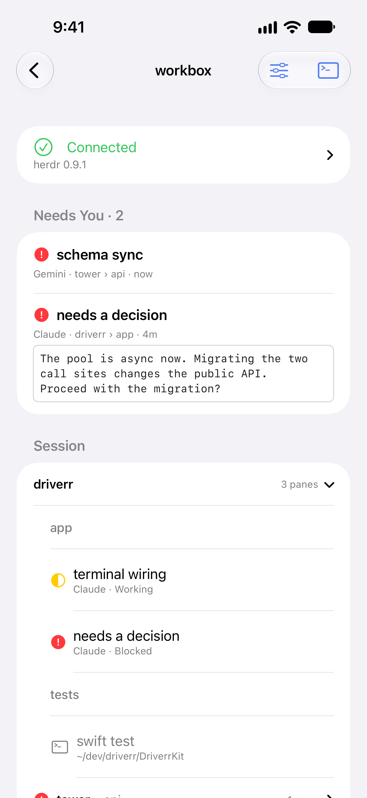
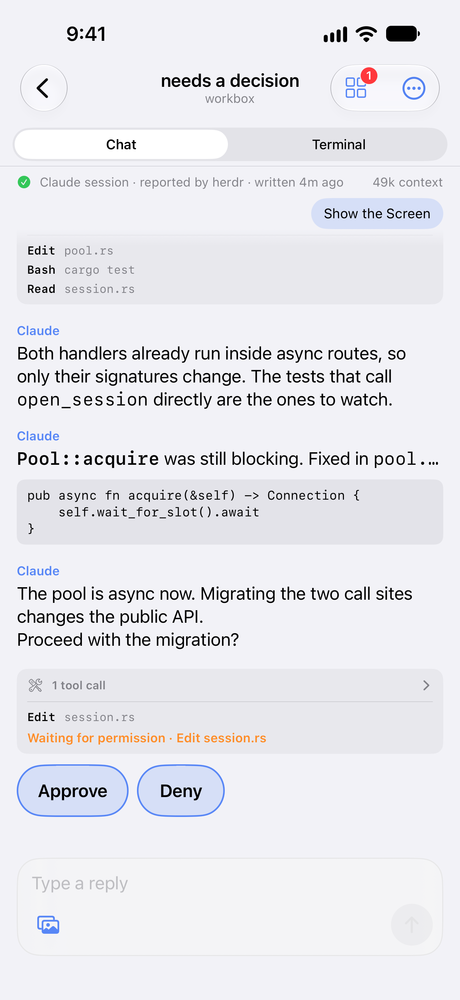

# Driverr

A free, native iOS and iPadOS SSH client built around
[herdr](https://github.com/herdrdev/herdr) — the terminal workspace manager that keeps
coding agents running in persistent background terminals. Driverr is an independent
project. It is not affiliated with or endorsed by the herdr project, Anthropic, OpenAI,
Google or Apple.

Most terminal apps treat herdr as one more TUI to render. Driverr treats it as what it is:
a remote object model. Workspaces, tabs, panes and agents are real SwiftUI screens driven
by herdr's newline-delimited JSON, and the terminal is one view among several rather than
the only one.

The specific thing Driverr does better than a general-purpose SSH client is tell you, on a
phone, that an agent is **waiting on you** — and let you answer it without reading a
terminal.

| Blocked agents, first | Answer without a terminal |
| --- | --- |
|  |  |

*Both are screenshots captured by the UI test suite against a seeded test session. That is
why they are identical on every run.*

## What it does

- **Needs you** — every blocked agent, collected at the top of the session and named with
  the workspace and tab it came from.
- **Reply without a terminal** — a Claude Code or Codex conversation shows as a chat. Type a
  reply in the composer below it, or attach an image. When the agent asks a question that
  has options, tap a reply chip under the question. For a permission prompt, the chips are
  Approve and Deny.
- **A real terminal when you want one** — attach to any pane, with a key row for the
  characters iOS hides, and themes and type sizes you can change while looking at it.
- **Pane controls** — rename or close a pane from the toolbar, and open a new one from the
  pane switcher.
- **herdr-core and the desktop app** — a host can run the herdr TUI,
  [herdr-core](https://github.com/herdrdev/herdr-core), the
  [Herdr desktop app](https://github.com/herdrdev/herdr-app), or more than one of them.
  Driverr finds what the host has when it connects, over the same SSH connection.
- **Keys and passwords** — generate or import an Ed25519 key, or use a password. Both live
  in the device Keychain.
- **Host keys checked** — Driverr remembers a host's key on first contact and stops hard if
  it ever changes.

Two non-goals shape it as much as the goals do. Driverr is **not a configuration surface** —
the entire settings screen is theme, font, font size, whether a captured pane screen wraps
its long lines, and whether Driverr draws Live Activities. And it is **not a paid product**.

Driverr has no backend. It talks directly to your own machines over SSH.

## Building it

The tests and `scripts/look.sh` run on a seeded fake session, so none of them needs a host.
Using the app by hand needs a machine you can reach over SSH. herdr is optional: a host
without herdr or herdr-core still opens as an ordinary SSH shell.

You need:

- A Mac with Xcode 27 and the iOS 27 simulator runtime
- Node.js and npm, which provide `npx`
- `python3`, which `scripts/look.sh` and `scripts/screenshots.sh` call
- Xcode's Metal toolchain component

The deployment target is iOS 26.0.

```sh
git clone https://github.com/cunderw/driverr.git
cd driverr
xcodebuild -downloadComponent MetalToolchain
xcrun simctl list devices available | grep -q '    Driverr iPhone 17 (' ||
  xcrun simctl create "Driverr iPhone 17" com.apple.CoreSimulator.SimDeviceType.iPhone-17
npx -y xcodebuildmcp@2.7.0 simulator build
```

The Metal step runs once per machine. It is not optional and not something the repo can
vendor around: Driverr renders its terminal with
[SwiftTerm](https://github.com/migueldeicaza/SwiftTerm), which
ships a Metal renderer, and a machine without the toolchain component fails the build with
`cannot execute tool 'metal'`.

Gates run through [XcodeBuildMCP](https://github.com/getsentry/MobileBuildMCP), which moved
from `getsentry/XcodeBuildMCP`. It is a third-party tool that `npx` downloads from npm. At
the pinned version it sends error reports and usage metrics to Sentry. The metrics include
the tool name, outcome and duration of each call, and tags such as the Xcode version. Its own
README calls this internal runtime error telemetry. `.xcodebuildmcp/config.yaml` sets
`sentryDisabled: true`, which the pinned version reads from the directory you run it in, so
telemetry is off for the commands in this file when you run them from the repository root.
The second route is `XCODEBUILDMCP_SENTRY_DISABLED=true` in your shell. `scripts/look.sh` and
`scripts/screenshots.sh` set it themselves. The tool's current
[Privacy & Telemetry page](https://www.mobilebuildmcp.com/docs/privacy) describes a newer
version, and it names the variable `MOBILEBUILDMCP_SENTRY_DISABLED`. Read that page again
when you change the pinned version.

`.xcodebuildmcp/config.yaml` is committed and names the project, scheme and simulator, so
none of the commands below need arguments. Driverr runs on its own named simulator,
`Driverr iPhone 17`, rather than the machine's stock device. The setup command above creates
that simulator only if no available device has the name. `simctl create` does not check
the name, so without the `grep` guard a second run makes a second device, and the scripts
here stop when two devices share a name. With no runtime argument, `simctl create` uses the
newest installed runtime the device type supports.

The iPad pass needs a second device, and only when you run it:

```sh
xcrun simctl list devices available | grep -q '    Driverr iPad (' ||
  xcrun simctl create "Driverr iPad" \
    com.apple.CoreSimulator.SimDeviceType.iPad-Pro-13-inch-M4-8GB
```

Keep the name and the device type together: an iPad name created with an iPhone type would
let the iPad checks pass against a phone. A third device, `Driverr iPhone 17 Pro Max`
(`iPhone-17-Pro-Max`), exists only to regenerate the App Store screenshots — contributing
does not need it.

| Command (all prefixed `npx -y xcodebuildmcp@2.7.0`) | What it runs |
| --- | --- |
| `simulator build` | The app |
| `swift-package test --package-path DriverrKit` | The kit suites — fast, no simulator, run these first |
| `simulator test --extra-args -only-testing:DriverrTests` | `DriverrTests` |
| `simulator test --extra-args -only-testing:DriverrUITests` | `DriverrUITests` — slow; see which classes to run in [`CONTRIBUTING.md`](CONTRIBUTING.md#which-tests-to-run) |
| `simulator build --configuration Release` | The app in the Release configuration, for a diff that touches `#if DEBUG` code |
| `simulator build --build-for-testing` | Warning sweep across both build systems |

Add `--output json` to any of them and the result carries the counts, the tests that
actually ran, and paths to the full log and result bundle.

Hosted CI runs the kit suites on every pull request and nothing else. Every other gate runs
locally, and a green claim is expected to come from
output you actually read — including a check that the tests you asked for are the ones that
ran, since xcodebuild exits 0 when a filter matches nothing.
[`CONTRIBUTING.md`](CONTRIBUTING.md#tests-and-where-they-belong) says which of these to run
for a given change, how to check what actually ran, and what a pull request has to show.

### Signing and identifiers

**A simulator build and every test need no Apple Developer team.** The app and the widget
extension build for the simulator with `CODE_SIGN_IDENTITY = "-"` and
`CODE_SIGNING_REQUIRED = NO`. The unit and UI test targets set `CODE_SIGNING_ALLOWED = NO`,
so the tests run on the simulator only. That is what the build settings say. Nobody has built
it on a Mac outside the owner's team.

The project file is set up for Apple Developer Team **447FMVD577**, with app bundle
identifier **com.cunderw.driverr**. The widget extension, unit tests and UI tests take
`.watch`, `.tests` and `.uitests` on the end of that. The app and the widget extension share
the app group **group.com.cunderw.driverr**, and deep links use the **driverr** URL scheme.
`DriverrWatch` is the Live Activity widget extension. It is not a watchOS app. Its bundle
identifier ends in `.watch`, the same string as the background task identifier
`BackgroundWatch.taskIdentifier`, and the two are not related.

To run on a device under your own team, change these in your working copy:

1. `DEVELOPMENT_TEAM` in `Driverr.xcodeproj/project.pbxproj`. It appears on four lines: the
   app and the widget extension, each in Debug and Release. It is one value.
2. `PRODUCT_BUNDLE_IDENTIFIER` on the same four lines. The widget extension's identifier must
   keep the app's identifier as its prefix.
3. The app group, in three places that must hold the same string:
   `Driverr/Driverr.entitlements`, `DriverrWatch/DriverrWatch.entitlements` and
   `WidgetThemeSnapshot.appGroupID` in `DriverrKit/Sources/DriverrCore/WidgetThemeSnapshot.swift`.
4. Optional: `bundleId` in `.xcodebuildmcp/config.yaml`. Only the tool commands that launch
   the app by bundle identifier read it.

These need no change, because they are plain strings and not tied to a team: the `driverr`
URL scheme, the Keychain service names, the `UserDefaults` keys, the logger subsystems and
the refresh task identifier in `Driverr/Info.plist`.

The identifier of the "Continue in Background" task, `BackgroundWatch.taskIdentifier`, and its
two entries in `Driverr/Info.plist` start with `com.cunderw.driverr`. Apple's documentation for
[`BGContinuedProcessingTaskRequest`](https://developer.apple.com/documentation/backgroundtasks/bgcontinuedprocessingtaskrequest/init(identifier:title:subtitle:))
says the prefix of the identifier must at least contain the bundle ID of the submitting
application. This document does not say whether "Continue in Background" works under another
bundle identifier, because that was not tested.

What to expect:

- `WidgetThemeSnapshotTests` pins the app group string, so it fails after step 3. That is
  expected on a local device build.
- A wrong or missing app group raises no error. The widget draws its fixed colours and not
  the app's theme.
- Commit none of these edits.

The values are in the project file, the two entitlements files and `Driverr/Info.plist`.
Those files are the sources, and this document is not.
[`CLAUDE.md`](CLAUDE.md#identifiers) has the rules for changing them.

## How it is put together

A SwiftUI app in `Driverr/` over a SwiftPM package in `DriverrKit/`, six modules:

| Module | Holds | Rule |
| --- | --- | --- |
| `DriverrCore` | Domain types, no dependencies | Everything else maps down to these |
| `DriverrSSH` | SwiftNIO SSH | NIOSSH types never leave it |
| `DriverrTerm` | SwiftTerm, wrapped | Does not import `DriverrSSH` |
| `DriverrHerdr` | herdr's wire format | herdr types never leave it |
| `DriverrHC` | herdr-core's framed protocol | Its wire types never leave it |
| `DriverrTranscript` | The session files of Claude Code and Codex | Their record types never leave it |

The boundaries are the point: they are what let stores be tested with no live SSH
connection and no live herdr socket, and what confines upstream churn to one file each.

- Conventions and the traps this project has already paid for: [`CLAUDE.md`](CLAUDE.md)

## Contributing

[`CONTRIBUTING.md`](CONTRIBUTING.md) is the whole workflow: what to open before you write
code, the label taxonomy, branch and pull request conventions, which tests to run for a
given change, the warnings check, and the evidence a pull request is expected to carry.
Issues are the source of truth for work. By taking part you agree to the
[Code of Conduct](CODE_OF_CONDUCT.md).

The release procedure is not kept in this repository.

## Support

Driverr is free. If it is useful to you, you can buy me a coffee.

[](https://buymeacoffee.com/cunderw)

## License

[MIT](LICENSE). The licenses and notices of the dependencies, the bundled font and the theme
palettes are in [`THIRD-PARTY-NOTICES.md`](THIRD-PARTY-NOTICES.md).
